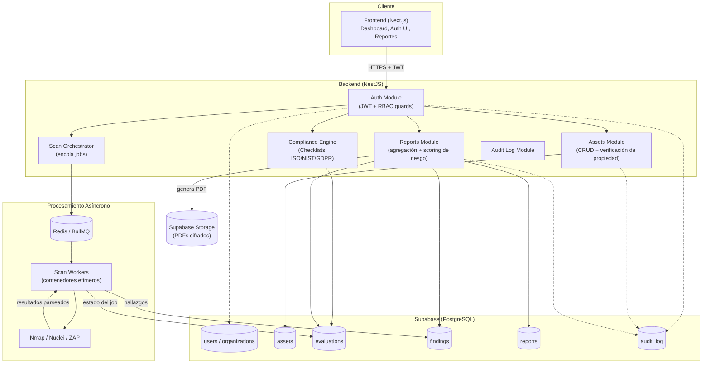

# Aegis CyberAudit — Arquitectura Técnica MVP

> Nota sobre supuestos: `a.md` es una plantilla con placeholders (`[Ej: ...]`) y no se adjuntaron documentos adicionales al directorio. Para poder entregar un diseño concreto y accionable, se completaron los placeholders con decisiones técnicas pragmáticas orientadas a velocidad de despliegue y bajo costo operativo. Estas decisiones están marcadas y se pueden ajustar sin cambiar la arquitectura general.

**Nombre del proyecto:** Aegis CyberAudit
**Propósito del MVP:** Automatizar evaluación de cumplimiento normativo (ISO 27001 / NIST CSF / protección de datos) y detección de vulnerabilidades básicas de red/web para Pymes.
**Público objetivo:** CISOs, auditores IT, administradores de sistemas.

---

## 0. Vacíos detectados en la especificación y recomendaciones

Antes de la arquitectura, estos son los puntos que `a.md` deja abiertos y que tienen impacto directo en seguridad o viabilidad del MVP:

| # | Vacío detectado | Riesgo | Solución propuesta |
|---|---|---|---|
| 1 | No se define quién autoriza el escaneo de un activo (IP/dominio) | Escanear activos sin autorización explícita puede ser **ilegal** (equivalente a un ataque no autorizado) | Módulo de "Autorización de Alcance": cada activo requiere una prueba de propiedad (registro DNS TXT, archivo en `/.well-known/`, o attestation firmada por un admin) antes de habilitar escaneos activos |
| 2 | No se especifica cifrado de hallazgos en reposo | Los hallazgos (vulnerabilidades, credenciales expuestas, CVEs) son datos altamente sensibles; una brecha en la propia plataforma de auditoría es catastrófica | Cifrado a nivel de columna para `findings.detail` y `findings.evidence` (pgcrypto o Supabase Vault), cifrado de disco por defecto, backups cifrados |
| 3 | No se define gestión de credenciales/secrets para integraciones (APIs de terceros, credenciales de activos internos) | Secrets en texto plano en DB o `.env` es un vector de compromiso total | Vault dedicado (Supabase Vault / HashiCorp Vault / AWS Secrets Manager) — nunca guardar credenciales de activos en la tabla `assets` |
| 4 | Multi-tenencia no está definida (¿una empresa por instancia o SaaS multi-cliente?) | Sin aislamiento, un bug de autorización filtra datos entre clientes | Diseño multi-tenant desde el día 1 con `organization_id` en cada tabla + Row Level Security (RLS) de Postgres, no solo chequeos en el backend |
| 5 | No hay mención de motor asíncrono para escaneos | Escaneos (Nmap/ZAP) pueden tardar minutos-horas; un endpoint síncrono bloquea y timeoutea | Cola de trabajos (BullMQ + Redis) con workers separados del API principal |
| 6 | RBAC mencionado pero sin roles definidos | Ambigüedad en implementación, riesgo de sobre-permisos | Definir roles mínimos: `owner`, `admin`, `auditor`, `viewer` (ver sección 2) |
| 7 | No se menciona registro de auditoría (quién vio/exportó qué hallazgo) | Requisito típico de ISO 27001 / SOC2 para plataformas que manejan hallazgos de seguridad | Tabla `audit_log` inmutable (solo INSERT) desde el Sprint 1 |
| 8 | No se define rate limiting ni protección contra abuso del motor de escaneo | Un usuario podría usar la plataforma para lanzar escaneos masivos hacia terceros | Rate limiting por organización + validación de que el activo esté verificado (ver punto 1) antes de encolar el escaneo |

---

## 1. Arquitectura de Sistema

### 1.1 Stack tecnológico (decisiones para el MVP)

- **Frontend:** Next.js 14 (App Router) + TypeScript + TailwindCSS + shadcn/ui — SSR para dashboard, un solo lenguaje (TS) compartido con backend.
- **Backend:** Node.js + NestJS (TypeScript) — estructura modular nativa, guards para RBAC, fácil de testear.
- **Base de datos:** Supabase (PostgreSQL) — Auth integrado, Row Level Security nativo para multi-tenencia, Storage para PDFs, acelera el MVP.
- **Cola / Jobs asíncronos:** Redis + BullMQ — desacopla escaneos largos del request-response del API.
- **Motor de escaneo:** Microservicio Python independiente que envuelve herramientas open-source:
  - `Nmap` (descubrimiento de puertos/servicios)
  - `Nuclei` (plantillas CVE/misconfig)
  - `OWASP ZAP Baseline` (escaneo pasivo web)
  Estas corren en contenedores aislados (uno por job) para evitar que un scan comprometa el resto de la infraestructura.
- **Reportes:** Playwright (HTML→PDF) o `react-pdf` para generación de reportes descargables.

### 1.2 Diagrama de flujo (Mermaid)



**Flujo resumido:**
1. El usuario se autentica (Frontend → Auth Module → JWT con `organization_id` y `role`).
2. Registra un activo (IP/dominio/repo) → el sistema exige verificación de propiedad antes de habilitar escaneo activo.
3. Selecciona un checklist de cumplimiento (ISO 27001 / NIST CSF / normativa local) → se crea una `evaluation`.
4. El Scan Orchestrator encola el job en Redis; un worker efímero ejecuta las herramientas de escaneo en un contenedor aislado.
5. Los resultados se normalizan y almacenan como `findings`, con severidad calculada.
6. El módulo de Reportes agrega hallazgos + checklist, calcula scoring de riesgo y genera un PDF/dashboard.
7. Toda acción sensible (crear activo, exportar reporte, ver hallazgo crítico) queda en `audit_log`.

---

## 2. Modelo de Datos (PostgreSQL / Supabase)

Diseño multi-tenant con `organization_id` + RLS. Tipos `severity`/`role`/`status` como ENUM para integridad.

```sql
-- ============================================================
-- EXTENSIONES
-- ============================================================
create extension if not exists "pgcrypto";
create extension if not exists "uuid-ossp";

-- ============================================================
-- ENUMS
-- ============================================================
create type user_role as enum ('owner', 'admin', 'auditor', 'viewer');
create type asset_type as enum ('ip', 'domain', 'repository', 'web_app');
create type asset_verification_status as enum ('pending', 'verified', 'failed');
create type evaluation_status as enum ('draft', 'queued', 'running', 'completed', 'failed');
create type finding_severity as enum ('critical', 'high', 'medium', 'low', 'info');
create type finding_status as enum ('open', 'accepted_risk', 'remediated', 'false_positive');
create type framework_type as enum ('iso27001', 'nist_csf', 'gdpr', 'local_dp_law');

-- ============================================================
-- ORGANIZACIONES Y USUARIOS
-- ============================================================
create table organizations (
    id              uuid primary key default uuid_generate_v4(),
    name            text not null,
    created_at      timestamptz not null default now()
);

-- Extiende auth.users de Supabase con datos de aplicación
create table profiles (
    id              uuid primary key references auth.users(id) on delete cascade,
    organization_id uuid not null references organizations(id) on delete cascade,
    full_name       text,
    role            user_role not null default 'viewer',
    created_at      timestamptz not null default now()
);
create index idx_profiles_org on profiles(organization_id);

-- ============================================================
-- ACTIVOS A AUDITAR
-- ============================================================
create table assets (
    id                  uuid primary key default uuid_generate_v4(),
    organization_id     uuid not null references organizations(id) on delete cascade,
    type                asset_type not null,
    value               text not null,              -- IP, dominio, URL de repo
    verification_status asset_verification_status not null default 'pending',
    verification_token  text,                        -- token esperado en DNS TXT / well-known
    verified_at         timestamptz,
    created_by          uuid not null references profiles(id),
    created_at          timestamptz not null default now(),
    unique (organization_id, type, value)
);
create index idx_assets_org on assets(organization_id);
create index idx_assets_verification on assets(verification_status);

-- ============================================================
-- FRAMEWORKS Y CONTROLES (checklists de cumplimiento)
-- ============================================================
create table compliance_controls (
    id              uuid primary key default uuid_generate_v4(),
    framework       framework_type not null,
    code            text not null,          -- ej: "A.9.2.1" (ISO), "PR.AC-1" (NIST)
    title           text not null,
    description     text,
    weight          numeric not null default 1.0,   -- ponderación para scoring
    unique (framework, code)
);
create index idx_controls_framework on compliance_controls(framework);

-- ============================================================
-- EVALUACIONES (una corrida de auditoría sobre uno o más activos)
-- ============================================================
create table evaluations (
    id              uuid primary key default uuid_generate_v4(),
    organization_id uuid not null references organizations(id) on delete cascade,
    asset_id        uuid not null references assets(id) on delete cascade,
    framework       framework_type not null,
    status          evaluation_status not null default 'draft',
    triggered_by    uuid not null references profiles(id),
    started_at      timestamptz,
    completed_at    timestamptz,
    risk_score      numeric,                 -- score agregado 0-100, calculado al completar
    created_at      timestamptz not null default now()
);
create index idx_evaluations_org on evaluations(organization_id);
create index idx_evaluations_asset on evaluations(asset_id);
create index idx_evaluations_status on evaluations(status);

-- Resultado por control dentro de una evaluación
create table evaluation_control_results (
    id              uuid primary key default uuid_generate_v4(),
    evaluation_id   uuid not null references evaluations(id) on delete cascade,
    control_id      uuid not null references compliance_controls(id),
    passed          boolean,
    notes           text,
    unique (evaluation_id, control_id)
);

-- ============================================================
-- HALLAZGOS (findings) — datos sensibles, cifrados a nivel de columna
-- ============================================================
create table findings (
    id              uuid primary key default uuid_generate_v4(),
    organization_id uuid not null references organizations(id) on delete cascade,
    evaluation_id   uuid not null references evaluations(id) on delete cascade,
    asset_id        uuid not null references assets(id) on delete cascade,
    source_engine   text not null,           -- 'nmap' | 'nuclei' | 'zap'
    title           text not null,
    severity        finding_severity not null,
    status          finding_status not null default 'open',
    cve_id          text,
    detail_encrypted    bytea,               -- pgp_sym_encrypt(detail, key)
    evidence_encrypted  bytea,               -- pgp_sym_encrypt(evidence, key)
    detected_at     timestamptz not null default now()
);
create index idx_findings_org on findings(organization_id);
create index idx_findings_evaluation on findings(evaluation_id);
create index idx_findings_severity on findings(severity);
create index idx_findings_status on findings(status);

-- ============================================================
-- REPORTES GENERADOS
-- ============================================================
create table reports (
    id              uuid primary key default uuid_generate_v4(),
    organization_id uuid not null references organizations(id) on delete cascade,
    evaluation_id   uuid not null references evaluations(id) on delete cascade,
    generated_by    uuid not null references profiles(id),
    storage_path    text not null,           -- path en Supabase Storage
    generated_at    timestamptz not null default now()
);
create index idx_reports_org on reports(organization_id);

-- ============================================================
-- AUDIT LOG (inmutable, solo INSERT)
-- ============================================================
create table audit_log (
    id              uuid primary key default uuid_generate_v4(),
    organization_id uuid not null references organizations(id) on delete cascade,
    actor_id        uuid references profiles(id),
    action          text not null,           -- ej: 'asset.created', 'report.exported'
    target_type     text,
    target_id       uuid,
    metadata        jsonb,
    created_at      timestamptz not null default now()
);
create index idx_audit_org_time on audit_log(organization_id, created_at desc);

-- ============================================================
-- ROW LEVEL SECURITY (aislamiento multi-tenant)
-- ============================================================
alter table assets enable row level security;
alter table evaluations enable row level security;
alter table findings enable row level security;
alter table reports enable row level security;
alter table audit_log enable row level security;

create policy tenant_isolation_assets on assets
    using (organization_id = (select organization_id from profiles where id = auth.uid()));
create policy tenant_isolation_evaluations on evaluations
    using (organization_id = (select organization_id from profiles where id = auth.uid()));
create policy tenant_isolation_findings on findings
    using (organization_id = (select organization_id from profiles where id = auth.uid()));
create policy tenant_isolation_reports on reports
    using (organization_id = (select organization_id from profiles where id = auth.uid()));
create policy tenant_isolation_audit on audit_log
    using (organization_id = (select organization_id from profiles where id = auth.uid()));
```

**Roles RBAC definidos:**
- `owner`: control total de la organización, incluye facturación/miembros.
- `admin`: gestiona activos, usuarios y frameworks.
- `auditor`: crea evaluaciones, lanza escaneos, gestiona hallazgos.
- `viewer`: solo lectura de reportes y dashboards.

---

## 3. Especificación de APIs / Endpoints REST

Prefijo base: `/api/v1`. Autenticación: `Authorization: Bearer <JWT>` (Supabase Auth). Todas las respuestas de error siguen `{ "error": { "code": "...", "message": "..." } }`.

### Auth & Usuarios
| Método | Ruta | Descripción | Payload |
|---|---|---|---|
| POST | `/auth/signup` | Registro de organización + owner inicial | `{ email, password, organization_name }` |
| POST | `/auth/login` | Login | `{ email, password }` |
| POST | `/auth/logout` | Invalida sesión | — |
| GET | `/users/me` | Perfil del usuario autenticado | — |
| GET | `/users` | Lista usuarios de la organización (`admin`+) | query: `?page=&limit=` |
| POST | `/users/invite` | Invita usuario con rol (`admin`+) | `{ email, role }` |
| PATCH | `/users/:id/role` | Cambia rol (`owner`) | `{ role }` |

### Activos (Assets)
| Método | Ruta | Descripción | Payload |
|---|---|---|---|
| GET | `/assets` | Lista activos de la organización | query: `?type=&status=` |
| POST | `/assets` | Crea activo (queda `pending`) | `{ type, value }` |
| GET | `/assets/:id` | Detalle de activo | — |
| POST | `/assets/:id/verify` | Dispara verificación de propiedad (DNS TXT / well-known) | — |
| DELETE | `/assets/:id` | Elimina activo (`admin`+) | — |

### Cumplimiento (Compliance Engine)
| Método | Ruta | Descripción | Payload |
|---|---|---|---|
| GET | `/frameworks` | Lista frameworks soportados | — |
| GET | `/frameworks/:framework/controls` | Lista controles de un framework | — |

### Evaluaciones y Escaneos
| Método | Ruta | Descripción | Payload |
|---|---|---|---|
| POST | `/evaluations` | Crea evaluación y encola escaneo (requiere `asset.verification_status = verified`) | `{ asset_id, framework }` |
| GET | `/evaluations` | Lista evaluaciones | query: `?status=&asset_id=` |
| GET | `/evaluations/:id` | Detalle + estado del job | — |
| GET | `/evaluations/:id/findings` | Hallazgos de la evaluación | query: `?severity=&status=` |
| PATCH | `/evaluations/:id/findings/:findingId` | Actualiza estado de un hallazgo (ej. `remediated`) | `{ status, notes }` |
| POST | `/evaluations/:id/cancel` | Cancela evaluación en curso | — |

### Reportes
| Método | Ruta | Descripción | Payload |
|---|---|---|---|
| POST | `/evaluations/:id/reports` | Genera PDF del reporte | — |
| GET | `/reports` | Lista reportes generados | — |
| GET | `/reports/:id/download` | URL firmada de descarga (expira) | — |

### Auditoría (solo `admin`+)
| Método | Ruta | Descripción | Payload |
|---|---|---|---|
| GET | `/audit-log` | Lista eventos de auditoría | query: `?actor_id=&action=&from=&to=` |

---

## 4. Plan de Implementación — Sprints (2 semanas c/u)

### Sprint 1 — Fundaciones y Auth
- Setup de monorepo (Next.js + NestJS + Supabase local).
- Auth: signup/login, `organizations`, `profiles`, RBAC guards en NestJS.
- RLS en todas las tablas desde el inicio (no como afterthought).
- Tabla `audit_log` + middleware que registra acciones sensibles automáticamente.
- CI básico (lint, typecheck, tests unitarios).

**Entregable:** usuario puede crear cuenta, invitar miembros con roles, y toda acción queda auditada.

### Sprint 2 — Activos y Motor de Verificación
- CRUD de `assets`.
- Flujo de verificación de propiedad (DNS TXT / well-known file) — **bloquea** escaneo hasta `verified`.
- Carga de `compliance_controls` (seed inicial de ISO 27001 Annex A + NIST CSF subset).
- Frontend: pantallas de gestión de activos y estado de verificación.

**Entregable:** un usuario registra un dominio/IP y completa la verificación de propiedad.

### Sprint 3 — Motor de Escaneo Asíncrono
- Microservicio Python con Nmap/Nuclei/ZAP en contenedores efímeros.
- Integración Redis/BullMQ: `evaluations` → job → worker → `findings`.
- Cálculo de severidad y normalización de resultados por motor.
- Cifrado de columnas sensibles (`detail_encrypted`, `evidence_encrypted`).
- Rate limiting por organización en `POST /evaluations`.

**Entregable:** un activo verificado puede ser escaneado end-to-end y los hallazgos aparecen en el dashboard.

### Sprint 4 — Reportes, Scoring y Pulido de MVP
- Cálculo de `risk_score` ponderado (severidad × peso del control).
- Generación de PDF (Playwright) con resumen ejecutivo + detalle técnico.
- Dashboard interactivo (gráficos de severidad, tendencia por activo).
- URLs firmadas de descarga con expiración.
- Hardening: revisión de policies RLS, pentest interno ligero, checklist de seguridad de la propia plataforma (dogfooding con su propio motor).

**Entregable:** MVP funcional completo — de registro de activo a reporte de cumplimiento descargable con hallazgos ponderados por riesgo.

---

## Próximos pasos sugeridos
1. Confirmar stack (¿NestJS es aceptable o prefieren Express/FastAPI?) y normativas locales específicas a soportar.
2. Definir el mecanismo exacto de verificación de propiedad de activos (crítico para uso legal del motor de escaneo).
3. Decidir estrategia de aislamiento de workers de escaneo (Docker-in-Docker, Firecracker, o servicio cloud gestionado) antes del Sprint 3.
